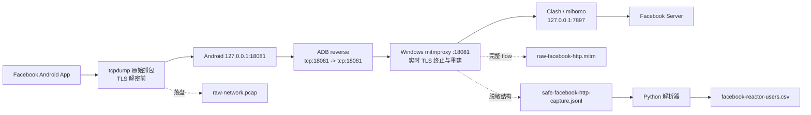
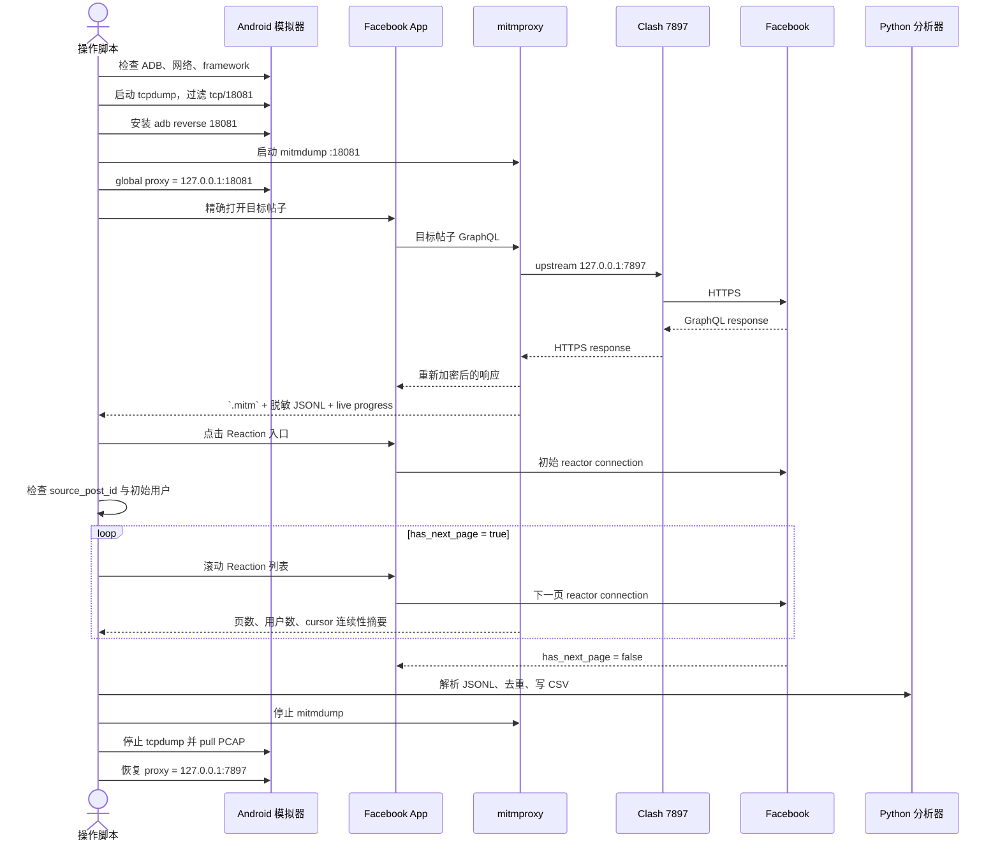
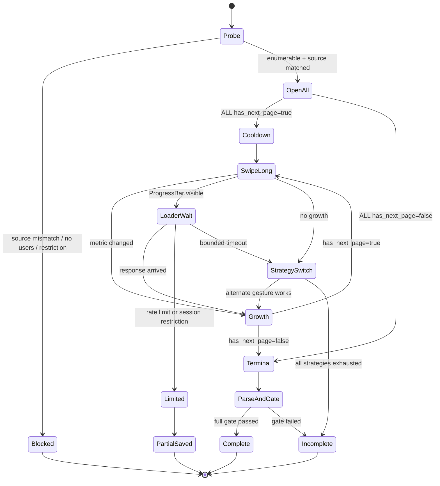

# Facebook Reaction 用户抓取全流程技术说明与 PPT 母稿

> 更新提示（2026-09-09）：本文的 3539 人终点分页案例仍是完整验收证据；9 月 8 日至 9 日新增 URL 样本均为首屏 `initial-ready`。最新差异表见 `../CURRENT_STATUS_2026-09-09.md`。

更新时间：2026-09-02  
适用项目：`C:\Users\lenovo\Desktop\facebook`  
文档性质：当前代码与真实运行证据说明，不是概念设计稿

## 0. 阅读前必须先知道的结论

这个方案的核心目标，是在 Android 模拟器中操作真实 Facebook App，让 App 自己发出 Reaction 用户列表请求，然后在本地被动捕获、解析和验证这些响应。

当前方案不是直接调用 Facebook 私有 GraphQL，也不是把旧请求重新发送一遍。抓取动作来自真实 App UI，程序只负责：

1. 建立稳定网络链路；
2. 严格打开指定帖子；
3. 打开 Reaction 用户列表；
4. 驱动列表滚动，使 App 自动请求下一页；
5. 同步保存 TLS 解密前和解密后的网络证据；
6. 从解密后的 GraphQL 响应中提取用户；
7. 对分页终点、目标帖子和用户唯一性做验证；
8. 无论成功或失败，都恢复模拟器原有代理环境。

当前完整流程共分为 **12 个步骤**。其中，原有核心抓取逻辑是“目标校验 -> Reaction 列表 -> 自适应分页 -> 解析去重 -> 完整性门控”。2026-09-01 至 2026-09-02 新增的是“在 mitmproxy 解密之前，用 Android `tcpdump` 同步保存原始 PCAP”这条证据链。

### 0.1 当前最重要的实现边界

`run_facebook_capture.ps1` 当前已经永久管理以下内容：

- ADB、Android 网络与 reverse 映射；
- mitmproxy 启停；
- 模拟器代理切换与恢复；
- 严格目标帖子验证；
- Reaction 列表探测和分页；
- `.mitm` 原始 HTTP flow；
- 脱敏 JSONL；
- Python 解析和 CSV 输出。

但是，`raw-network.pcap` 的 tcpdump 启停、拉回和删除远端临时文件，当前仍由运行时一次性外层包装脚本完成，尚未永久合并进 `run_facebook_capture.ps1`。

因此当前可以准确表述为：

> 原始 PCAP + MITM + JSONL + CSV 的完整链路已经真实跑通；但如果今后只单独调用主脚本，默认不会自动生成 PCAP，还需要将外层 tcpdump 逻辑正式集成进去。

### 0.2 数据边界

本文不展示：

- Cookie；
- Authorization；
- access token；
- 原始 cursor；
- Reaction 用户姓名或用户明细；
- 其他可用于复用登录会话的敏感字段。

文档中的用户数、页数、状态码和文件名只用于证明流程与结果完整性。

## 1. 项目目标与问题背景

### 1.1 要解决的问题

Facebook 帖子页面通常会显示 Reaction 总数，但“页面上有总数”和“能够得到对应用户列表”是两件不同的事。

真正需要解决的问题包括：

- 如何确保打开的是指定帖子，而不是 App 中残留的旧帖子；
- 如何准确找到 Reaction 用户列表入口；
- 如何判断列表是否真正加载，而不是只显示空壳或 loading；
- 如何确认 GraphQL 响应属于指定帖子；
- 如何持续触发下一页，而不是只获取初始 25 至 50 人；
- 如何判断已经到达最后一页；
- 如何处理重复用户、分页重叠和字段结构变化；
- 如何同时保留解密前与解密后的网络证据；
- 如何避免 Cookie、Authorization、token 等信息进入普通分析文件；
- 如何在限流、会话限制、错误帖子或 UI 卡死时及时停止；
- 如何在抓取结束后恢复原代理，避免影响模拟器继续使用。

### 1.2 为什么不直接使用普通页面爬虫

这个场景不是典型的静态 HTML 抓取：

- Reaction 用户列表由 Facebook App 动态加载；
- 数据通过 App 自己的 GraphQL 请求返回；
- 列表分页依赖真实 UI 滚动状态；
- 请求中包含 App 会话、内部变量和动态 cursor；
- 当前实现刻意不重放请求，也不手工伪造 cursor；
- 目标帖子和用户可见范围受当前 App 会话影响。

因此最可靠的思路不是脱离 App 重新实现一套客户端，而是让 App 正常工作，程序在旁边观察并验证。

## 2. 总体架构

### 2.1 完整网络拓扑



### 2.2 正常使用与抓包状态的区别

正常使用时：

```text
Facebook App
-> Android global proxy 127.0.0.1:7897
-> adb reverse tcp:7897 tcp:7897
-> Windows Clash 127.0.0.1:7897
-> Facebook
```

抓包时：

```text
Facebook App
-> Android global proxy 127.0.0.1:18081
-> tcpdump 同步记录 TLS 包
-> adb reverse tcp:18081 tcp:18081
-> Windows mitmproxy :18081
-> upstream 127.0.0.1:7897
-> Facebook
```

抓包结束后必须回到正常代理 `127.0.0.1:7897`。

### 2.3 PCAP、MITM、JSONL、CSV 的区别

| 文件 | 所处位置 | 是否解密 | 内容特点 | 主要用途 |
|---|---|---:|---|---|
| `raw-network.pcap` | 模拟器网络接口 | 否 | TCP、TLS 握手和加密应用数据 | 证明原始线上流量真实发生 |
| `raw-facebook-http.mitm` | mitmproxy 内部 | 是 | 完整 HTTP request/response flow | 深度复查、mitmweb 检查、保留原始解密证据 |
| `raw-facebook-http-index.jsonl` | mitmproxy addon | 是，但只保存索引 | host、path、friendly name、状态码、大小 | 快速定位 flow，不必先打开完整 `.mitm` |
| `safe-facebook-http-capture.jsonl` | 安全捕获 addon | 是，且脱敏 | GraphQL 响应正文、必要请求结构、分页状态 | 日常分析输入与实时进度来源 |
| `facebook-live-progress.json` | 安全捕获 addon | 聚合状态 | 页数、用户数、terminal、限流、目标来源 | 自适应分页控制面 |
| `facebook-reactor-users.csv` | Python 分析器 | 结构化结果 | 去重后的可见 Reaction 用户 | 最终业务结果 |

### 2.4 最容易混淆的解密关系

错误理解：

```text
先拿到 raw-network.pcap
-> 事后用某个密钥解密
-> 生成 raw-facebook-http.mitm
```

实际过程：

```text
同一个 App 请求
├─ tcpdump 在网络接口旁路保存 TLS 密文 -> raw-network.pcap
└─ 流量继续进入 mitmproxy
   -> mitmproxy 在运行时终止 App 侧 TLS
   -> 读取 HTTP
   -> 再与 Facebook 建立新的 TLS
   -> 保存 raw-facebook-http.mitm 和安全 JSONL
```

`.mitm` 不是由 PCAP 事后解密而来；两者是同一时间窗、同一流量在不同处理层分别产生的文件。

## 3. 端到端执行时序



## 4. 十二步完整流程

## 4.1 第一步：运行前环境检查与独占控制

### 目标

保证抓取开始前，ADB、模拟器、Android 系统服务、代理出口和 UI 控制均处于可用状态，并防止后台 watchdog 与抓取脚本同时操作设备。

### 具体实现

主入口是 `run_facebook_capture.ps1`。在开始任何抓取动作前，它会：

1. 暂停 Facebook transport watchdog；
2. 检查目标设备是否为 `device`；
3. 必要时恢复 offline ADB；
4. 检查 Android framework services；
5. 准备 UI dump helper；
6. 检查 mitmdump 可执行文件；
7. 检查 Android 默认网络；
8. 检查主机代理 `127.0.0.1:7897`；
9. 清理只属于本项目的陈旧 mitmdump listener；
10. 拒绝占用他人或未知进程的端口。

关键代码：

- `run_facebook_capture.ps1:669-687`
- `facebook_transport.ps1:194-210`
- `facebook_transport.ps1:285-301`

### 为什么要暂停 watchdog

watchdog 平时负责发现代理或网络状态异常并自动修复。但抓包时程序会故意把代理从 `7897` 改成 `18081`。如果 watchdog 同时运行，它可能把这个临时状态误判为故障并恢复代理，导致流量绕过 mitmproxy。

### 常见问题

| 现象 | 可能原因 | 处理逻辑 |
|---|---|---|
| ADB 显示 offline | 模拟器刚启动、adbd 重连 | 有界等待并允许一次服务恢复 |
| UI dump 超时 | System UI 卡顿、ANR、instrumentation 不可用 | 尝试 helper；必要时回退 legacy UIAutomator |
| `7897` 不监听 | Clash 未启动或退出 | 启动 Clash 并等待端口 |
| `18081` 被占用 | 上一次 mitmdump 异常残留或未知程序占用 | 只清项目进程；未知 listener 直接停止当前任务 |
| capture marker 残留 | 上次抓取非正常退出 | 验证 owner 和 mitm PID，不存活才清理 |

### 成功标准

- ADB 状态是 `device`；
- Android default network 不是 `none`；
- 主机 `7897` 正在监听；
- UI 能够读取；
- 没有冲突的 capture listener；
- watchdog 已暂停，当前抓取独占 ADB 控制面。

## 4.2 第二步：启动 Android 原始 PCAP 抓包

### 目标

在 mitmproxy 解密之前，保存 App 到抓包代理之间的原始 TCP/TLS 数据。

### 当前真实实现

完整全量运行通过一次性外层包装脚本启动：

```powershell
$RemotePcap = "/data/local/tmp/fb-reaction-full-<timestamp>.pcap"
$startCommand = "tcpdump -i any -s 0 -U -w $RemotePcap tcp port 18081 >/dev/null 2>&1 & echo `$!"
adb -s emulator-5554 shell $startCommand
```

参数含义：

| 参数 | 含义 |
|---|---|
| `-i any` | 监听模拟器所有网络接口，避免只选 `lo` 时遗漏接口差异 |
| `-s 0` | 不截断 packet，保存完整包 |
| `-U` | packet 尽快刷新到文件，降低异常退出时的数据损失 |
| `-w` | 以标准 PCAP 格式写文件 |
| `tcp port 18081` | 只保留 App 与本地抓包代理之间的流量 |
| `echo $!` | 返回后台 tcpdump PID，供结束时精确停止 |

### 为什么 PCAP 中看不到用户名

PCAP 保存的是 TLS record。即使能看到 TCP 连接、源/目标端口、数据长度和时序，也不会直接看到 GraphQL 名称、JSON 字段或 Reaction 用户姓名。

这正是它作为“原始网络包”的含义：数据还没有经过 mitmproxy 的 TLS 终止。

### 常见问题

| 现象 | 原因 | 处理方式 |
|---|---|---|
| `tcpdump inaccessible or not found` | 冷启动后 adbd 不是 root | `adb root` 后等待设备重新上线 |
| PCAP 文件只有全局头 | tcpdump 启动了，但请求没经过 18081 | 检查 Android proxy 和 reverse 映射 |
| PCAP 开始时间晚于 MITM | tcpdump 启动太晚 | 必须先启动 tcpdump，再启动主抓取 |
| 停止后 PCAP 尾部损坏 | 直接强杀，没有给 tcpdump flush 时间 | 优先发送 SIGINT，并等待后再 pull |

### 产物

`runs/<run-id>/raw-network.pcap`

### 成功标准

- tcpdump 返回有效 PID；
- `kill -0 <pid>` 成功；
- 远端 PCAP 持续增大；
- pull 后本地文件非空，PCAP magic 有效；
- 文件时间窗覆盖目标打开和 Reaction 分页。

## 4.3 第三步：建立 ADB reverse 端口映射

### 目标

让模拟器中的 `127.0.0.1:<port>` 映射到 Windows 主机相同端口。

### 实现方式

`facebook_transport.ps1` 对每个需要的端口执行：

```powershell
adb -s emulator-5554 reverse tcp:<port> tcp:<port>
```

本轮涉及：

- `7897`：正常 Clash 出口；
- `8081`：历史兼容抓包端口；
- `18081`：本次 PCAP + MITM 实验端口。

安装后读取 `adb reverse --list`，逐一用正则确认映射存在。仅执行命令但不回读，不算成功。

### 为什么不用 `10.0.2.2`

旧方案曾使用 Android Emulator 特殊地址 `10.0.2.2` 访问宿主机。当前正式方案统一使用 `127.0.0.1 + adb reverse`，原因是：

- 网络路径更明确；
- 不依赖 Emulator NAT 特殊地址；
- 与 Android global proxy 的本地地址一致；
- 更容易检测、恢复和隔离抓包端口。

### 问题点

- 模拟器或 adb server 重启后 reverse 可能消失；
- Android 的 `127.0.0.1` 默认指向模拟器自身，不安装 reverse 就无法到达 Windows；
- 只看到 proxy 字符串正确，不代表目标端口实际可达。

### 成功标准

`adb reverse --list` 中存在：

```text
tcp:18081 tcp:18081
tcp:7897  tcp:7897
```

## 4.4 第四步：启动 mitmproxy 实时解密

### 目标

在 Windows `18081` 接收模拟器代理流量，实时获得解密后的 HTTP request/response，并通过 Clash 发往 Facebook。

### 实现方式

主脚本构造的核心参数：

```powershell
mitmdump `
  --quiet `
  --listen-host 0.0.0.0 `
  --listen-port 18081 `
  --mode upstream:http://127.0.0.1:7897 `
  -s facebook_capture_addon_safe.py `
  -s facebook_raw_flow_writer.py
```

对应代码：`run_facebook_capture.ps1:689-731`。

两个 addon 分工：

1. `facebook_raw_flow_writer.py`
   - 只保留 Facebook、fbcdn、fbsbx、Instagram 相关 host；
   - 用 mitmproxy `FlowWriter` 保存完整 flow；
   - 每个 flow ID 只写一次；
   - 每次写入后 flush；
   - 同时生成不含正文的索引 JSONL。
2. `facebook_capture_addon_safe.py`
   - 清除 Cookie、Authorization、token 等敏感字段；
   - 保存分析所需的响应正文；
   - 提取目标来源、cursor 哈希连续性、page_info 和 GraphQL 错误；
   - 更新实时分页状态。

### mitmproxy 如何解密

mitmproxy 不是破解 Facebook TLS 算法，也不是从 PCAP 猜密钥。它依靠模拟器中已经信任的 mitmproxy CA：

1. Facebook App 连接 mitmproxy；
2. mitmproxy 动态签发一个 Facebook 域名证书给 App；
3. App 与 mitmproxy 建立第一条 TLS；
4. mitmproxy 解开这条 TLS，得到 HTTP；
5. mitmproxy 再与 Facebook 建立第二条 TLS；
6. 请求和响应在两条 TLS 之间被实时转发。

### 问题点

- CA 未被模拟器或 App 接受，TLS 无法建立；
- App 使用证书固定时，系统 CA 信任仍可能不够；
- 上游 `7897` 不通，mitmproxy 能接到 App，但到不了 Facebook；
- `18081` 已被未知程序占用；
- mitmdump 启动后立即退出，但外层没有检查进程存活。

### 成功标准

- mitmdump 启动 3 秒后仍存活；
- Windows `18081` 有 listener；
- `.mitm`、索引 JSONL 或安全 JSONL 开始增长；
- GraphQL flow 的 HTTP 状态和正文可被解析。

## 4.5 第五步：切换模拟器代理并建立抓取边界

### 目标

让后续 Facebook App 请求强制经过 mitmproxy，并向 watchdog 标记“当前代理变化是有意的”。

### 实现方式

主脚本先写 `.facebook-capture-active.json`，包含：

- owner PID；
- mitmdump PID；
- 抓包端口；
- 开始时间。

然后执行：

```powershell
adb shell settings put global http_proxy 127.0.0.1:18081
adb shell settings get global http_proxy
```

写入值和回读值必须完全一致。

### 为什么顺序重要

正确顺序是：

```text
tcpdump
-> reverse
-> mitmdump
-> capture marker
-> Android proxy 18081
-> 打开 Facebook / 目标帖子
```

如果先打开 App 再切代理，目标帖子首批请求可能已经走正常 `7897`，PCAP 和 MITM 都会缺少关键证据。

### 问题点

- settings 写入成功但没有回读验证；
- capture marker 没写，watchdog 把代理恢复；
- reverse 已丢失，代理指向 `127.0.0.1:18081` 但端口不可达；
- App 使用旧连接池，需要 force-stop 后重新启动才能完整建立新连接。

### 成功标准

- Android global proxy 等于 `127.0.0.1:18081`；
- capture marker 存在且 PID 有效；
- App 发出的新连接出现在 PCAP 和 mitmproxy 中。

## 4.6 第六步：严格打开并验证目标帖子

### 目标

证明后续 Reaction 数据属于指定帖子，而不是 Facebook App 中的旧页面、推荐帖子或搜索结果。

### 为什么 UI 看起来正确仍不够

Facebook App 可能出现：

- VIEW intent 触发了 GraphQL prefetch，但界面仍停在旧帖子；
- 搜索响应中包含目标数字，但只是搜索关键词；
- 分享短链跳转到错误内容；
- 复合 permalink 被 App 接受，却最终导航到另一帖子；
- 旧 capture 中已经有相同 ID，导致错误复用历史证据。

所以目标验证必须使用“这次打开动作之后的新网络响应”。

### 实现过程

1. force-stop `com.facebook.katana`，但不清账号数据；
2. 记录当前安全 JSONL 行数，下一行作为 verification boundary；
3. 如果 URL 是 `story.php`，转换为更适合 Android intent 的帖子 URL；
4. 使用 `android.intent.action.VIEW`，并将 package 固定为 `com.facebook.katana`；
5. 处理 Android 应用选择器；
6. 等待目标页面请求；
7. 调用 `analyze_facebook_capture.py --require-target-match`；
8. 只分析 boundary 之后的记录；
9. SearchResults 类请求永远不能作为 matched；
10. exit 3 表示“窗口内尚未匹配”，每 2 秒有界重试；
11. 其他 analyzer error 立即失败；
12. 验证成功后记录 resolved post ID、author ID 和匹配方法。

关键代码：`open_facebook_post_readonly.ps1:247-416`。

### 目标验证状态

| 状态 | 含义 | 后续动作 |
|---|---|---|
| `matched` | 新 GraphQL 证据与目标一致 | 允许进入 Reaction 列表 |
| `target-not-confirmed-in-capture` | 有请求，但不能证明是目标 | 停止或有界重试 |
| `capture-jsonl-not-created` | 打开动作没有产生可分析请求 | 停止 |
| analyzer error | 解析器异常或输入异常 | 立即失败 |

### 成功标准

`target-open-diagnostics.json` 必须满足：

```text
verified = true
reason = target-confirmed-in-capture
resolved_post_id = expected post
```

仅仅“页面上看到了帖子”不算通过。

## 4.7 第七步：打开 Reaction 列表并执行初始探测

### 目标

确认 Reaction 列表入口真实存在、列表已经加载、当前账号能够看到用户节点，并且初始 Reaction 请求属于目标帖子。

### 查找入口的顺序

1. 在严格目标帖子页面查找 Reaction 数字节点；
2. 找不到数字时查找 Reaction 图标摘要；
3. 在限定次数内轻微滚动，尝试揭示帖子摘要；
4. 如果 feed surface 不适合定位，则通过评论入口进入帖子详情；
5. 在评论详情中向上揭示顶部 Reaction 摘要；
6. 明确拒绝把 Page Info 页面当成 Reaction 列表入口。

### 打开后如何判断页面真的准备好

程序使用 UI 树把状态分为：

- `reaction-list-loading`：标题、返回按钮、搜索或 ProgressBar 已出现，但内容未准备好；
- `reaction-list`：有 Reaction tabs 或内容列表，且不再是纯 loading；
- 其他状态：列表打开失败。

如果是 loading，会按 `ReactionListReadyAttempts` 和 `ReactionListReadyDelaySeconds` 有界等待。

### 新鲜 source proof

列表打开后，还要从最新的 `FeedbackReactorsGraphService*` 请求中读取 `source_post_id`：

- 必须至少有一条 Reaction query；
- observed source ID 必须唯一；
- 唯一 source ID 必须等于 expected post ID；
- 没有 proof 或 proof mismatch 时，不允许点击 tab，也不允许分页。

### Screening 分类

| 分类 | 条件 | 是否进入深分页 |
|---|---|---:|
| `enumerable` | 已出现至少一个可见 reactor 用户节点 | 是 |
| `visibility-restricted` | UI 明确提示只能看到好友姓名 | 否 |
| `not-enumerable` | 有 query 但没有用户，或 query 未触发 | 否 |
| `target-mismatch` | source ID 与目标不一致 | 否 |

`ReactionProbeOnly` 模式只执行到这里，不进入 page 2，用于检查会话是否健康。

### 问题点

- Reaction 数字没有出现在当前 viewport；
- 点击到了普通表情按钮，而不是人数入口；
- UI 列表出现，但没有产生新请求，可能使用缓存；
- 有请求但只有数量，没有用户节点，属于可见性边界；
- App 串帖，source ID 不一致；
- session 已被临时限制；
- GraphQL 返回 HTTP 200，但正文中实际是错误码。

### 成功标准

```text
classification = enumerable
probe_status = initial-ready
user_count > 0
observed_source_post_ids = [expected post]
```

## 4.8 第八步：驱动 ALL Reaction 流自适应分页

### 目标

持续滚动当前 Reaction 用户列表，让 Facebook App 请求下一页，直到服务端明确返回 `has_next_page=false`。

### 为什么优先 ALL 流

初始 Reaction 列表本身就是 `__ALL__` connection。ALL 流的用户节点中已经带有 `feedback_reaction_info`，可以同时知道每个用户使用的 Reaction 类型。

因此当前策略是：

1. 先把 ALL 流分页到底；
2. ALL 已 terminal 时，不再重复点击 Like、Love 等分类；
3. 只有无法识别 ALL 流时，才考虑有限分类 tab；
4. 本次全量运行将 `ReactionTabLimit=0`，完全不走分类 tab。

这样能减少冗余请求，也降低 session 压力。

### 自适应预算

本次全量参数：

| 参数 | 值 | 含义 |
|---|---:|---|
| `ReactionScrollCount` | 60 | 初始滚动预算 |
| `ReactionExtensionChunk` | 6 | 仍在增长时每次扩展 6 |
| `ReactionAbsoluteCap` | 0 | 不设置固定硬上限，允许扩展到 terminal |
| `ReactionPipelineBurstSize` | 2 | live progress 正常时，每个生产周期最多连续滑 2 次 |
| `ReactionNativeScrollEnabled` | 0 | 本轮使用经过验证的 ADB swipe |
| `ReactionTabLimit` | 0 | 不遍历分类 tab |
| `ReactionRateLimitMaxConsecutive` | 1 | 一次明确限流即停止本轮 |

`ReactionAbsoluteCap=0` 不是无限盲目滚动。程序仍然有以下停止条件：

- terminal；
- source mismatch；
- session restriction；
- rate limit；
- open connection 长时间没有增长；
- 所有 UI trigger 策略耗尽；
- App 或 UI 状态异常。

### 分页手势策略

默认依次尝试：

```text
long -> medium -> short -> rebound -> wait-long
```

正常状态优先 long swipe。只有连续无增长时才切换策略。一旦备用策略重新带来增长，立即恢复 long，避免后续每页都使用慢速恢复策略。

### 生产者/消费者模型

分页不是每滑一次都固定 sleep 很久，而是：

```text
生产者：ADB swipe 驱动 RecyclerView
消费者：mitmproxy 持续捕获响应
控制面：facebook-live-progress.json 聚合页数与用户数
```

如果两次 swipe 结束时响应已经到达，程序立即消费最新进度，不额外等待。只有没有增长时才进入短轮询或 UI 检查。

### 如何判断增长

增长 metric 组合以下字段：

```text
query_records | page_count | user_count | latest_line
```

只要 metric 改变，就说明新的 Reaction 响应已经进入 capture。

### Loader backpressure

如果 UI dump 看到列表底部 `ProgressBar`，说明 Facebook 已经在加载下一页。此时程序不会继续快速 swipe，而是短轮询 capture progress，等待以下任一结果：

- 用户或页数增长；
- terminal；
- rate limit；
- session restriction；
- 有界等待超时。

这能避免 App 已在请求时重复施压。

### 限流与会话限制

GraphQL 错误可能仍然返回 HTTP 200，所以不能只检查 HTTP status。

当前重点识别：

- GraphQL `1675004`：Reaction 分页限流；
- GraphQL `3252001` / API `368`：临时功能限制；
- response 中的通用 GraphQL errors；
- source-less rate-limit record。

一次限流后，程序可以按指数退避；本次全量运行将连续阈值设为 1，所以明确限流会立即停止并保留已有数据。

### terminal 的唯一正确含义

对于 ALL connection：

```json
{
  "page_info": {
    "has_next_page": false
  }
}
```

出现这一状态才说明当前账号可见的 ALL 用户连接已经翻到末尾。

以下状态都不能声称完整：

- `absolute-cap`；
- `base-budget-complete`；
- `open-no-recent-growth`；
- `ui-trigger-exhausted`；
- `partial-open-tail`；
- `rate-limited`；
- `session-restricted`；
- `target-mismatch`。

### 成功标准

```text
reaction_key = __ALL__
terminal_seen = true
stop_reason = terminal
```

## 4.9 第九步：同步保存三层证据

### 目标

为一次抓取同时保留：网络原始性、HTTP 可解释性和日常分析安全性。

### 第一层：原始 TLS 网络证据

文件：`raw-network.pcap`

能证明：

- 对应时间段存在真实 TCP/TLS 流量；
- 流量经过指定抓包端口；
- 包数量、方向、长度和时间顺序可审计。

不能直接证明：

- 某个用户名在响应中；
- 某个 GraphQL friendly name；
- 某个 JSON 字段值。

因为这些内容仍在 TLS 密文中。

### 第二层：完整解密 HTTP flow

文件：`raw-facebook-http.mitm`

能用于：

- 使用 `mitmweb` 重新打开；
- 查看原始 request/response；
- 排查安全 JSONL 解析遗漏；
- 验证 GraphQL response 的真实结构；
- 后续兼容 Facebook 字段变化。

风险：该文件可能包含敏感会话信息，不能作为普通 PPT 附件或对外共享材料。

### 第三层：脱敏分析数据

文件：`safe-facebook-http-capture.jsonl`

安全 addon 会处理：

- `access_token`；
- `authorization`；
- `cookie`；
- `set-cookie`；
- `fb_dtsg`；
- `session_id`；
- 变量名中含 token、cookie、authorization、session 的字段；
- URL query value；
- 原始 cursor。

原始 cursor 不落盘，只保存：

- cursor 是否存在；
- 上一页 end cursor 是否存在；
- 当前 cursor 哈希是否等于上一页 end cursor 哈希；
- 页面是否前进。

### 成功标准

- 三层文件来自同一个 run 目录；
- 时间窗一致；
- `.mitm` 可以重新读取；
- JSONL parse errors 为 0；
- 普通分析输出不包含 Cookie、Authorization、token 或原始 cursor。

## 4.10 第十步：解析、标准化、去重并输出 CSV

### 目标

把不同 GraphQL 响应结构中的 Reaction 用户统一成稳定表格。

### 解析输入

解析器只处理 friendly name 以 `FeedbackReactorsGraphService` 开头的记录。

它能解析：

- 单个 JSON 文档；
- 一次 HTTP response 中连续返回的多个 JSON 文档；
- GraphQL 中不同嵌套位置的 connection；
- `reactors`；
- `important_reactors`；
- `friend_reactors`；
- `edges[].node`；
- `nodes[]`；
- 节点内的 actor/user/profile 包装结构。

### 用户字段标准化

输出字段：

| 字段 | 来源 | 说明 |
|---|---|---|
| `line` | JSONL 行号 | 便于回到原始证据 |
| `user_id` | `id` 或 `strong_id__` | 用户稳定标识 |
| `user_name` | `name` | 当前响应返回的显示名 |
| `avatar_url` | profile picture 结构 | 仅在响应实际返回时写入 |
| `source_post_id` | 请求/响应目标字段 | 数据所属帖子 |
| `original_content_id` | 请求上下文 | 原始内容标识 |
| `reaction_id` | 节点 `feedback_reaction_info.id` 优先 | 用户使用的 Reaction 类型 |
| `source_field` | reactors 等 | 用户来自哪个 connection |
| `page_has_next_page` | page_info | 用户所在页是否还有下一页 |
| `page_end_cursor_present` | page_info | 该页是否返回 end cursor |

### 去重规则

主键为：

```text
(source_post_id, user_id)
```

当用户 ID 缺失时才回退为：

```text
(source_post_id, name:<user_name>)
```

如果同一用户在多个页面重复出现，保留第一条，并用后续记录补充第一条中缺失的字段。

### 为什么会有重复

- GraphQL 相邻页可能有边界重叠；
- `important_reactors` 与普通 `reactors` 可能包含同一用户；
- 初始页和分页页可能重复返回置顶用户；
- UI 切换或 App 重试可能重复发出同一 connection page。

因此“原始节点数”不能直接当作最终用户数。

### 输出文件

- `analysis/facebook-reactor-users.csv`
- `analysis/facebook-reaction-counts.csv`
- `analysis/facebook-posts.csv`
- `analysis/facebook-sample-patterns.json`
- `analysis/facebook-sample-patterns.md`

### 成功标准

- JSONL 解析错误为 0；
- CSV 能以 UTF-8 BOM 正常被 Excel 打开；
- 同一源帖下用户主键唯一；
- 所有 Reaction 记录的 source post 与目标一致；
- 空字段保持空，不编造头像、reaction 或 ID。

## 4.11 第十一步：完整性判定与 release gate

### 目标

避免把“抓到数据”错误表述为“抓取完整”。

### 两个层次

链路通：

```text
query_records > 0
user_count > 0
source_post_id matched
```

完整抓取：

```text
ALL terminal = true
stop_reason = terminal
deep_capture_completed = true
deep_completion_status = terminal-complete
```

### 分析器完整性状态

| 状态 | 含义 | 是否允许完整声明 |
|---|---|---:|
| `complete` | terminal 且不存在计数差额 | 是 |
| `complete-terminal-visible-subset` | 当前可见 connection 已 terminal，但 UI 总数更高 | 只能声明当前账号可见部分已翻完 |
| `partial-open-tail` | 最后一页仍 has_next_page=true | 否 |
| `partial-no-terminal` | 有页面但没见 terminal | 否 |
| `rate-limited` | 分页被限流中断 | 否 |
| `session-restricted` | 会话被临时限制 | 否 |
| `no-reaction-pages` | 没有有效 Reaction connection | 否 |

### Full gate 条件

`facebook_release_gate.py full` 同时要求：

```python
deep_capture_completed is True
deep_completion_status == "terminal-complete"
deep_completion_reason == "terminal"
reaction_user_count >= min_users
```

只有四项同时满足，进程才 exit 0。

### 为什么 UI 总数也要比对

如果 UI 总数为 3539，去重后的唯一用户也为 3539，且 terminal=true，则可形成相互独立的三重证明：

1. 服务端 page_info 明确结束；
2. 唯一用户数达到页面报告总数；
3. release gate 通过。

但如果 UI 总数高于唯一用户数，而 connection 已 terminal，可能是可见性限制或计数语义差异，不能伪造缺失用户。

## 4.12 第十二步：停止抓包并恢复环境

### 目标

确保成功、失败、异常三种情况下都不会留下代理、mitmdump、tcpdump 或临时文件。

### 主脚本 finally

`run_facebook_capture.ps1` 在 `finally` 中：

1. 停止 mitmdump；
2. 等待 mitmdump 退出和 flow flush；
3. 清除 capture marker；
4. 重新确认 ADB；
5. 必要时恢复 Android 网络；
6. 重新安装 reverse 映射；
7. 将 Android proxy 恢复为 `127.0.0.1:7897`；
8. 回读代理；
9. 移除临时环境变量；
10. 如果没有 batch owner，则恢复 watchdog。

### 外层 tcpdump finally

一次性包装脚本：

1. 向 tcpdump PID 发送 SIGINT；
2. 等待 2 秒 flush；
3. `adb pull` 到当前 run 的 `raw-network.pcap`；
4. 检查 pull exit code；
5. 删除 `/data/local/tmp` 中的远端 PCAP；
6. 输出 run dir、主脚本 exit code、pull exit code和 PCAP 大小；
7. 只要主抓取、pull 或本地文件任一失败，包装脚本 exit 1。

### 问题点

- 主脚本成功，但 PCAP pull 失败；
- tcpdump 已自然退出，`kill` 返回 No such process，却被包装脚本误当成致命错误；
- 先删除远端文件再确认本地文件；
- 代理恢复失败但脚本仍报告成功；
- watchdog 恢复成多个实例；
- mitmdump 被强杀前没有 flush `.mitm`。

### 成功标准

```text
Android proxy = 127.0.0.1:7897
tcpdump = stopped
mitmdump = stopped
port 18081 listener = absent
capture marker = absent
remote PCAP = absent
local raw-network.pcap = present and nonzero
watchdog = resumed
```

## 5. 分页控制状态机



## 6. 真实全量运行证据

### 6.1 Run 目录

`runs/reaction-full-smoke-20260902-120331`

### 6.2 结果汇总

| 指标 | 实际值 |
|---|---:|
| 唯一 Reaction 用户 | 3539 |
| GraphQL Reaction connection 页 | 143 |
| 原始节点行 | 3564 |
| 分页重叠/重复行 | 25 |
| 分页增长事件 | 140 |
| 滚动尝试 | 282 |
| 有效滑动/增长 | 2.014 |
| 分页用时 | 302878 ms，约 5 分 03 秒 |
| 每次增长耗时 | 2.163 秒 |
| 每分钟增长 | 27.734 次 |
| JSONL 解析错误 | 0 |
| Reaction 限流记录 | 0 |
| 临时功能限制记录 | 0 |
| 最后一页 `has_next_page` | false |
| UI 报告总数 | 3539 |
| 唯一用户与 UI 总数差额 | 0 |
| release gate | passed |
| 最终状态 | `terminal-complete` |

### 6.3 抓包文件

| 文件 | 大小 | 当前验证 |
|---|---:|---|
| `raw-network.pcap` | 5,977,951 字节 | 标准 PCAP 文件，原始 TLS 层 |
| `raw-facebook-http.mitm` | 19,007,640 字节 | 326 个 HTTP flow，324 个 GraphQL-like flow，可重新读取 |
| `safe-facebook-http-capture.jsonl` | 13,588,935 字节 | 325 条分析记录，解析错误 0 |
| `facebook-reactor-users.csv` | 639,984 字节 | 3539 个去重用户 |

### 6.4 Full gate 实际输出语义

```json
{
  "passed": true,
  "reason": "terminal-complete",
  "reaction_user_count": 3539,
  "reaction_page_count": 143,
  "deep_capture_completed": true,
  "deep_completion_status": "terminal-complete",
  "deep_completion_reason": "terminal",
  "attempts": 282,
  "growth_events": 140
}
```

### 6.5 能证明什么

- 目标帖子严格匹配；
- 当前账号能够枚举该帖 Reaction 用户；
- ALL connection 从初始页连续分页到 terminal；
- 去重后用户数与页面总数一致；
- 本轮没有限流、GraphQL 错误或会话限制；
- PCAP、MITM、安全 JSONL、CSV 均已落盘；
- 主抓取结束后代理和后台运行环境已恢复。

### 6.6 不能扩大解释为什么

这次成功不能自动推出：

- 所有 Facebook 帖子都能得到全部用户；
- 所有账号的可见范围相同；
- 所有版本的 Facebook App 都接受当前 mitmproxy CA；
- 未来 GraphQL 字段永远不变化；
- 只要 UI 总数存在就一定能枚举用户；
- PCAP 本身可以直接看到用户数据。

## 7. 失败点与诊断矩阵

| 阶段 | 现象 | 根因分类 | 程序应如何处理 | 是否保留部分数据 |
|---|---|---|---|---:|
| 环境 | ADB offline | 本地设备 | 有界恢复，失败则终止 | 否 |
| 环境 | `7897` 不监听 | 上游代理 | 启动 Clash 或终止 | 否 |
| PCAP | tcpdump 不可访问 | adbd 非 root | 重新 root，再启动前验证 | 否 |
| Reverse | proxy 正确但无流量 | reverse 丢失 | 重新安装并回读 | 否 |
| MITM | mitmdump 立即退出 | 端口/参数/addon | 最多三次有界启动 | 否 |
| TLS | App 无法联网 | CA/pinning | 检查证书信任与 App 行为 | 否 |
| 目标 | UI 看似打开但网络不匹配 | 旧 surface/错误跳转 | strict analyzer exit 3 | 否 |
| 入口 | 找不到 Reaction 数字 | UI 结构差异 | 评论详情归一化、有限揭示 | 否 |
| 列表 | 一直 loading | 网络或 UI 状态 | 有界等待后返回失败 | 可能 |
| Probe | query=0 | 未触发/缓存 | `not-ready`，不深分页 | 否 |
| Probe | query>0 但 users=0 | 可见性或结构变化 | `not-enumerable`，不盲重试 | 是，保留响应 |
| Target guard | source mismatch | 串帖 | 立即停止，不污染目标结果 | 是，隔离保存 |
| 分页 | 无增长 | UI 未触底/loader/手势失效 | 轮询、loader backpressure、切策略 | 是 |
| 分页 | HTTP 200 + 1675004 | GraphQL 限流 | 退避或熔断 | 是 |
| 分页 | 3252001 / API 368 | 会话限制 | 立即停止重任务 | 是 |
| 完整性 | 最后一页仍 open | 未抓完 | 标记 partial-open-tail | 是 |
| 输出 | JSONL 解析错误 | 响应结构/截断 | 保留 `.mitm`，不伪造字段 | 是 |
| 恢复 | proxy 未回 7897 | finally 异常 | 明确报告恢复失败 | 已有结果仍可用，但环境未恢复 |
| PCAP | pull 失败 | ADB/路径/远端文件 | 整体证据链判定不完整 | MITM/CSV 仍保留 |

## 8. 为什么 Proxyman 可能看不到下拉请求

Proxyman 与 mitmproxy 本质上都属于 HTTPS 调试代理，但安装了软件不代表 App 流量一定经过它。

常见原因：

1. 模拟器代理仍指向 Clash，而不是 Proxyman；
2. 模拟器中的 `127.0.0.1` 没有通过 adb reverse 映射到主机；
3. Proxyman 监听的是另一个端口；
4. Proxyman CA 没有被模拟器或 Facebook App 接受；
5. App 存在证书固定；
6. 下拉时只是滚动已加载的本地数据，没有产生新请求；
7. 列表下一页走了已有 HTTP/2 连接，但过滤条件没有显示该连接；
8. 操作没有真正到列表底部，没有触发 page 2；
9. 页面显示的是数量，不是可枚举用户 connection；
10. session 被限制，请求返回 GraphQL error，但使用者只看了 HTTP status；
11. 请求名称或 host 被过滤掉；
12. App 流量通过 native/特殊通道，没有经过所配置的系统代理。

本项目之所以能看到，是因为路径被明确固定为：

```text
Android global proxy 18081
-> adb reverse 18081
-> mitmproxy 18081
-> Clash 7897
```

并且每一步都回读验证，而不是只假设配置已经生效。

## 9. 主要代码文件与职责

| 文件 | 主要职责 | 关键位置 |
|---|---|---|
| `run_facebook_capture.ps1` | 总调度、mitmproxy、代理切换、调用 target/explorer/analyzer、finally 恢复 | 104、684、734、738、848、1045、1088 |
| `facebook_transport.ps1` | ADB、reverse、proxy、marker、网络和 watchdog helper | 194、232、346 |
| `open_facebook_post_readonly.ps1` | 精确打开帖子、capture boundary、严格 target match | 247、322、365 |
| `explore_facebook_readonly.ps1` | UI 入口、Reaction screening、ALL-first、自适应分页、terminal | 978、2103、2273、2412、2484 |
| `facebook_raw_flow_writer.py` | `.mitm` 完整 flow 与索引写入 | 68-110 |
| `facebook_capture_addon_safe.py` | 脱敏 JSONL、GraphQL 错误、cursor 摘要、live progress | 64、680、757、798 |
| `analyze_facebook_capture.py` | GraphQL 解码、reactor 标准化、去重、完整性和 CSV | 817、881、984、1048、1315 |
| `facebook_release_gate.py` | Probe、page2、full 和 Share 的机器门控 | 168-201 |

## 10. 当前实现的优点

1. **真实 App 驱动**：不伪造 GraphQL 请求和 cursor。
2. **目标严格绑定**：只有网络证据匹配目标帖才继续。
3. **ALL-first**：减少重复分类请求和账号压力。
4. **实时控制面**：不需要每次重扫全部 JSONL 才知道是否增长。
5. **自适应分页**：增长时快速推进，停滞时切换策略。
6. **Loader backpressure**：App 正在加载时不重复施压。
7. **限流熔断**：HTTP 200 内的 GraphQL error 也能识别。
8. **三层证据**：PCAP、完整 MITM、安全 JSONL 各自承担不同用途。
9. **敏感字段隔离**：日常分析文件不保存认证信息和原始 cursor。
10. **可证明完整**：terminal、唯一用户数和 release gate 共同判定。
11. **失败也有价值**：保留部分数据和诊断，不把未知值编造成结果。
12. **环境可恢复**：抓取结束自动回到正常代理和 watchdog。

## 11. 当前仍需改进的地方

### 11.1 将 PCAP 正式集成进主调度

当前最大工程缺口是 tcpdump 仍在一次性外层包装脚本中。建议正式加入：

- `-EnableRawNetworkCapture`；
- `-RawNetworkInterface any`；
- `-RawNetworkFilter "tcp port <ProxyPort>"`；
- `Start-FacebookRawNetworkCapture`；
- `Stop-FacebookRawNetworkCapture`；
- finally 中无条件 pull 和清理；
- PCAP 文件大小、SHA256、包数和时间窗摘要；
- PCAP 失败是否影响整轮退出码的明确策略。

### 11.2 生成统一 run manifest

建议每个 run 新增 `run-manifest.json`，至少记录：

- run ID；
- 开始/结束时间；
-目标帖子匿名标识；
- App、Android、mitmproxy 版本；
- 代理和端口；
- PCAP/MITM/JSONL/CSV 的路径、大小和 SHA256；
- 用户数、页数、terminal；
- rate limit 和 restriction 数；
- 环境恢复检查。

### 11.3 将 PPT 可视化指标自动化

建议从 diagnostics 自动生成：

- 用户数随页数增长曲线；
- 每页新增唯一用户数；
- 请求耗时分布；
- swipe 到 growth 的转化率；
- PCAP、MITM、JSONL 文件大小对比；
- 分页状态时间线。

### 11.4 对外展示版本

建议生成只包含以下信息的脱敏演示包：

- 架构图；
- 无真实 ID 的运行参数；
- 汇总指标；
- 失败状态说明；
- 不含用户名的示例 CSV schema；
- 不含 request/response 正文的 flow index 样例。

不要直接把 `.mitm` 或原始安全 JSONL 放进 PPT 附件。

## 12. PPT 建议结构

下面可以直接作为 PPT 目录。建议做 **20 页左右**，技术汇报控制在 15 至 25 分钟。

### 第 1 页：标题

标题：

> 基于 Android 真实 App 流量的 Facebook Reaction 用户抓取与原始网络证据保存

副标题：

> 从 UI 驱动、TLS 抓包、实时解密到终点完整性验证

本页只放标题、日期和项目名称。

### 第 2 页：问题背景

要讲的内容：

- Facebook 页面显示 Reaction 总数；
- 但用户明细是动态列表；
- UI、网络、账号可见性和分页状态共同决定结果；
- 普通网页爬虫无法覆盖完整链路。

建议一句话：

> 难点不是拿到第一批用户，而是证明这些用户属于目标帖子，并证明列表已经翻到服务端终点。

### 第 3 页：项目目标

列出五个目标：

1. 真实 App 发请求；
2. 严格绑定目标帖子；
3. 获取当前账号可见 Reaction 用户；
4. 保存解密前与解密后的证据；
5. 用 terminal gate 证明完整性。

### 第 4 页：方案边界

强调：

- 不重放私有 GraphQL；
- 不伪造 cursor；
- 不在普通输出中保存认证信息；
- 不自动点赞、评论、分享；
- 不把账号不可见数据编造成结果。

### 第 5 页：总体架构

使用本文“完整网络拓扑”Mermaid 图转成图片。

讲解重点：

- PCAP 位于解密前；
- MITM 位于 TLS 中间终止点；
- Clash 仍是最终上游出口；
- CSV 来自脱敏 JSONL，不直接解析 PCAP。

### 第 6 页：为什么要三层证据

用表格比较：

- PCAP：原始但不可读正文；
- MITM：完整可读但敏感；
- 安全 JSONL/CSV：适合分析和展示。

### 第 7 页：TLS 解密原理

使用“两条 TLS 连接”图：

```text
App <== TLS A ==> mitmproxy <== TLS B ==> Facebook
```

强调：MITM 不是事后从 PCAP 解密。

### 第 8 页：十二步流程总览

只列 12 个步骤名称：

1. 环境检查；
2. tcpdump；
3. adb reverse；
4. mitmproxy；
5. 代理切换；
6. 目标校验；
7. Reaction probe；
8. ALL 分页；
9. 三层落盘；
10. 解析去重；
11. 完整性门控；
12. 环境恢复。

### 第 9 页：目标帖子严格校验

展示：

```text
打开 URL
-> 建立 capture 行号边界
-> 只分析新 GraphQL
-> source/post token matched
-> 才允许进入 Reaction
```

强调 SearchResults 不能作为目标证明。

### 第 10 页：Reaction 初始探测

展示 screening 四分类：

- enumerable；
- visibility-restricted；
- not-enumerable；
- target-mismatch。

强调只有 `enumerable + source matched` 才进入重分页。

### 第 11 页：ALL-first 分页策略

讲解：

- 初始列表就是 ALL connection；
- 用户节点自带 reaction type；
- 先翻 ALL，避免分类重复请求；
- 本次不遍历 tab。

### 第 12 页：自适应分页状态机

使用本文“分页控制状态机”图。

重点解释：

- growth；
- loader backpressure；
- gesture fallback；
- terminal；
- rate-limit/session restriction 熔断。

### 第 13 页：如何判断最后一页

核心只放：

```json
"has_next_page": false
```

旁边列出不能代表完整的状态：预算耗尽、暂时无增长、限流、会话限制、open tail。

### 第 14 页：数据解析与去重

展示结构：

```text
FeedbackReactorsGraphService
-> reactors / important_reactors / friend_reactors
-> normalize actor
-> key = source_post_id + user_id
-> CSV
```

可加入 3564 原始节点 -> 3539 唯一用户 -> 25 重复行。

### 第 15 页：完整性门控

展示四项条件：

- deep completed；
- terminal-complete；
- reason=terminal；
- users >= expected threshold。

强调“抓到一些用户”和“抓完整”是两个不同验收层级。

### 第 16 页：真实运行结果

建议大数字展示：

- 3539 个唯一用户；
- 143 页；
- 5 分 03 秒；
- 0 限流；
- 0 会话限制；
- terminal-complete。

### 第 17 页：效率指标

展示：

- 282 次滚动；
- 140 次增长；
- 2.014 swipe/growth；
- 2.163 秒/growth；
- 27.734 growth/min。

可制作柱状图或 KPI 卡片。

### 第 18 页：问题与保护机制

用两列表：

| 问题 | 保护机制 |
|---|---|
| 串帖 | source guard |
| loading | 有界等待 |
| 无增长 | 自适应手势 |
| loader | backpressure |
| 限流 | 熔断 |
| session restriction | 停止重任务 |
| 敏感数据 | 分层存储与脱敏 |
| 异常退出 | finally 恢复代理 |

### 第 19 页：当前不足与下一步

重点写：

1. PCAP 外层包装尚未永久集成；
2. 应增加统一 run manifest；
3. 应自动生成分页增长图；
4. 应制作对外脱敏演示包；
5. 应对 App 版本变化持续做回归。

### 第 20 页：总结

建议总结语：

> 本方案不是单一抓包工具，而是一条从真实 App 行为、目标身份校验、分页控制、证据分层、数据解析到完整性证明的闭环。新增原始 PCAP 后，既能证明流量真实发生，又能通过 MITM 和解析结果解释其业务内容。

## 13. PPT 图表与截图建议

### 推荐放入的图

1. 网络拓扑图；
2. 端到端时序图；
3. 分页状态机；
4. 3564 原始节点到 3539 唯一用户的去重漏斗；
5. PCAP/MITM/JSONL/CSV 文件大小柱状图；
6. 页数或时间与累计唯一用户数增长曲线；
7. 完整性 gate 四条件图。

### 可以截图的本地材料

- `readonly-ui/reaction-list.xml` 转换后的 UI 层级示意；
- `readonly-ui/exploration-diagnostics.json` 中的 terminal 和分页统计；
- `analysis/facebook-sample-patterns.json` 中的完整性摘要；
- release gate 的脱敏 JSON 输出；
- Wireshark 打开的 PCAP，只展示 TLS、端口和时间，不展示任何敏感正文；
- mitmweb 的 flow 列表，只展示 friendly name 和状态，不展示 Cookie/Authorization/body。

### 不应截图或放入 PPT 的材料

- `.mitm` 中的完整 headers；
- Cookie、Authorization、token；
- 原始 GraphQL variables；
- 原始 cursor；
- Reaction 用户姓名列表；
- 真实账号登录信息；
- 可复用会话状态。

## 14. 汇报时容易被问到的问题

### Q1：PCAP 是不是解密后的包？

不是。`raw-network.pcap` 是 mitmproxy 之前的 TLS 密文。

### Q2：MITM 文件是不是从 PCAP 解密出来的？

不是。PCAP 和 MITM 同步产生。mitmproxy 在流量经过时实时解密并保存 HTTP flow。

### Q3：为什么 mitmproxy 能解密？

因为模拟器信任 mitmproxy CA，App 与 mitmproxy 建立 TLS，mitmproxy 再与 Facebook 建立另一条 TLS。

### Q4：CSV 是从哪里来的？

CSV 来自脱敏 JSONL 中的 `FeedbackReactorsGraphService` 响应，不是直接从 PCAP 解析。

### Q5：为什么不用 Proxyman？

工具不是关键，关键是 App 流量是否真实经过代理、CA 是否被接受、端口映射是否正确，以及下拉是否真正触发新请求。Proxyman 理论上也可以承担 HTTPS 调试代理角色。

### Q6：3539 是页面数字还是用户明细数？

两者一致：页面报告总数为 3539，GraphQL terminal 后去重得到 3539 个唯一用户，差额为 0。

### Q7：143 页为什么不是 143 次滚动？

一次新页面可能需要多次滚动触发；本轮 282 次滚动、140 次增长，加上初始页形成 143 个 connection page 记录。

### Q8：为什么一定要 terminal？

只有服务端返回 `has_next_page=false`，才能证明当前可见 connection 已到末尾。没有 terminal，只能称为部分结果。

### Q9：遇到限流怎么办？

识别 GraphQL 错误后停止或退避，保留已有数据和 cursor 连续性摘要，不继续高频触发。

### Q10：是否能保证每个帖子都抓全？

不能。是否可枚举取决于当前账号可见性、帖子类型、App UI、会话状态和服务端策略。系统保证的是正确分类和不虚报完整。

### Q11：是不是只增加了一个步骤？

从业务抓取逻辑看，是在原流程前后增加了一组 PCAP 生命周期操作：开始前启动 tcpdump，结束后停止、拉回和清理。目标打开、Reaction 分页、解析去重的核心逻辑没有改变。

### Q12：当前能不能一条主脚本命令自动得到 PCAP？

当前还不能准确这么说。全量实跑是通过一次性外层包装脚本完成 PCAP 生命周期；主脚本本身尚未永久集成 tcpdump。

## 15. 最终结论

本项目已经形成一个可验证的 Facebook Reaction 用户抓取闭环：

```text
真实 App UI
-> 精确目标帖子
-> Reaction 初始可枚举性探测
-> ALL connection 自适应分页
-> 服务端 terminal
-> 用户标准化与去重
-> 完整性 gate
-> 环境恢复
```

在这个闭环之外，又增加了一条同步的原始网络证据链：

```text
App 到 mitmproxy 之前
-> tcpdump
-> raw-network.pcap
```

最终一次真实全量运行得到 3539 个唯一用户、143 个 Reaction connection 页，最后一页 `has_next_page=false`，用户数与页面总数差额为 0，且没有限流、会话限制或解析错误。PCAP、MITM、安全 JSONL 和 CSV 均已保存。

因此当前阶段可以证明两件事：

1. Reaction 用户抓取主链路已经完整跑通；
2. TLS 解密前的原始 PCAP 可以与解密后的 MITM、脱敏数据和最终 CSV 在同一运行时间窗内同步保存。

当前后续最明确的工程动作，是把已经验证的一次性 tcpdump 包装逻辑正式并入 `run_facebook_capture.ps1`，使三层证据真正成为主入口的一等能力。
