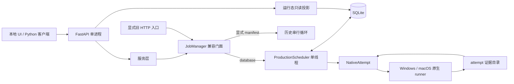
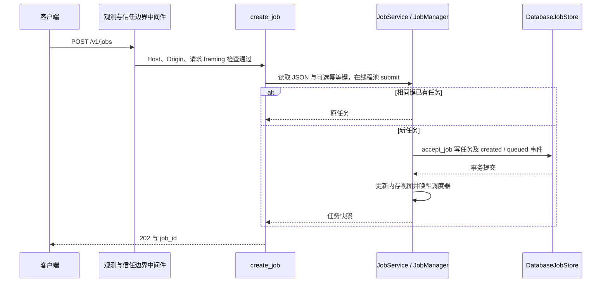
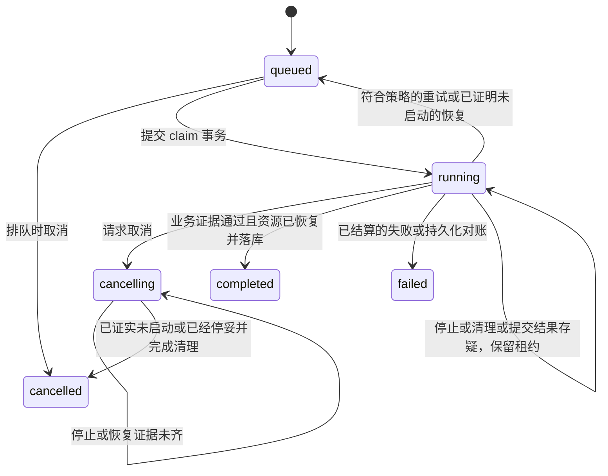
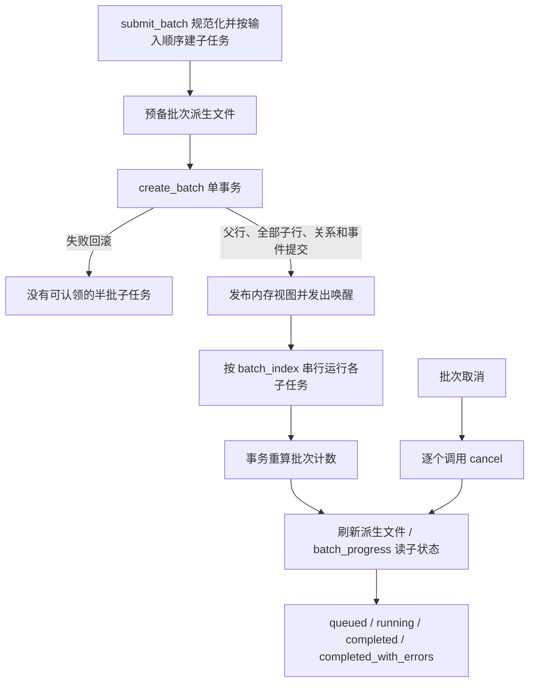
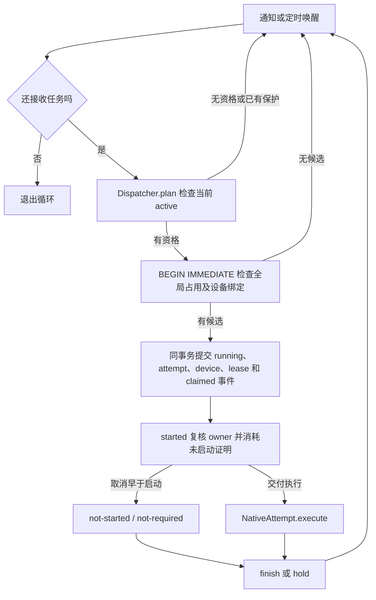
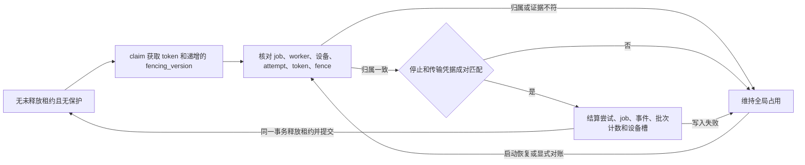
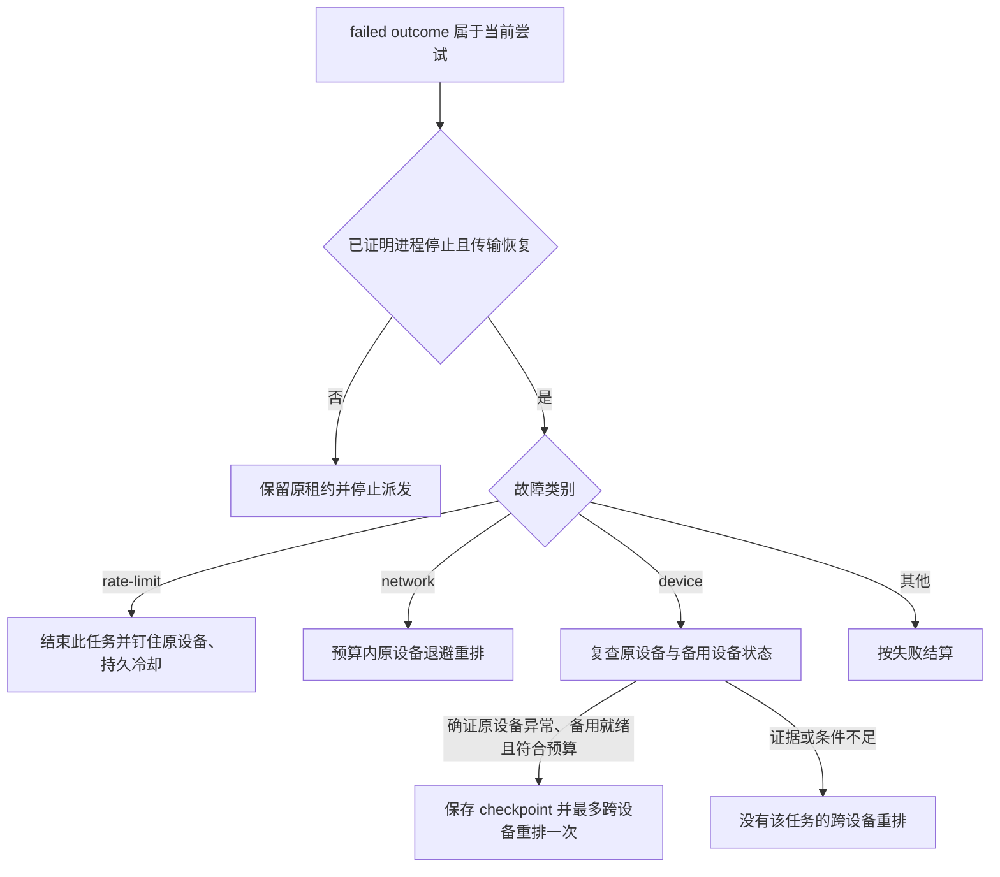
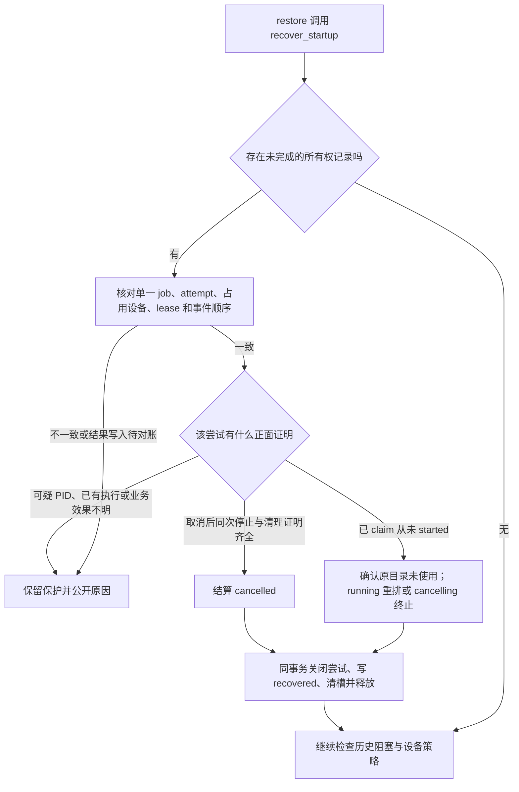
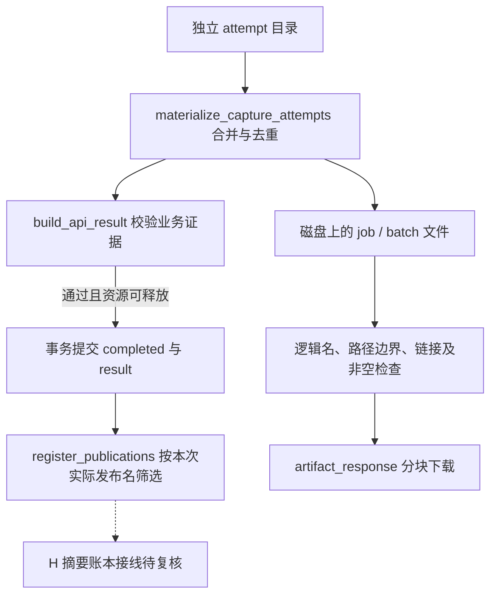
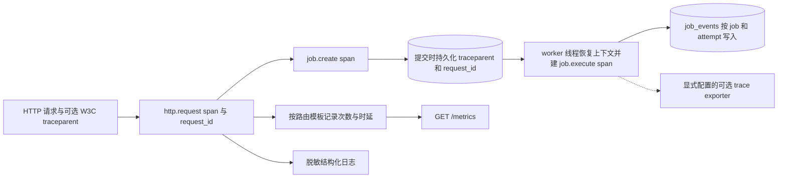

# v1.1 最终架构评审（开发分支）

`codex/backend-v1.1-production-completion` 的原生入口已把数据库任务交给一个 `ProductionScheduler` 线程。SQLite 管任务、尝试、事件和租约，文件系统保存逐次运行证据。一次只允许一个任务控制一台设备。本文按工作树中的调用点审阅。**代码已接入、隔离测试覆盖、真实平台验收是三项独立结论。** [Phase A 基线审计](V1.1-AUDIT.md)记录早期实现，[测试说明](TESTING.md)记录验证分层。

## 1. Overall Architecture · 系统与状态所有者

默认启动时，`create_app.lifespan` 先取得状态根与 SQLite 路径的所有者锁，再选 store 并构造门面。`JobManager._start_worker` 根据 store 选择一个线程入口。数据库模式用 SQL 决定下一个任务，内存对象用于兼容读接口和唤醒。显式 manifest 模式才进入 `_worker_loop`。原生设备执行与未来 Docker 控制面分开，后者见第 11 节。[启动与关停](../../facebook_backend/main.py#L116) · [选库及迁移门禁](../../facebook_backend/persistence/state_startup.py#L180) · [模式与线程选择](../../facebook_capture_api.py#L2435) · [只读连接](../../facebook_backend/services/runtime_snapshot.py#L37)

## 2. API Request Flow · 提交为何返回 202

无效请求按原有错误结构处理。客户端可用同一个 `Idempotency-Key` 重放单任务提交，键限 200 个字符。持久化错误不会返回已受理的新任务。受理与完成之间需轮询状态，再读 result 或下载产物。未知状态需保留同一幂等键复核，不能把批次 POST 当成具有同样的幂等约定。[请求与响应](../../facebook_backend/api/routes/jobs.py#L52) · [服务错误映射](../../facebook_backend/services/job_service.py#L39) · [重放与发布顺序](../../facebook_capture_api.py#L2855) · [受理事务](../../facebook_backend/persistence/job_store.py#L277)

## 3. Job Lifecycle · 任务状态与保护原因

`execution-unverified` 和 `failed-result-persistence` 是 `recovery_state`，不是新的公开 job 状态。后者只在无活跃执行且停止/清理证据齐备、原尝试与 fence/token 全部匹配后，才接受明确确认，结算为 `failed` 或 `cancelled`。对账不补造成功结果。`completed` 的原生调用还检查 target/source、查询触发、分页终点、visibility 和 completeness。仅好友可见是可见子集，空数组本身不足以确认空名单，显式受限采样按 `bounded-sample` 标识。[取消与保护](../../facebook_backend/scheduler/production_transactions.py#L146) · [结算与对账](../../facebook_backend/scheduler/production_transactions.py#L182) · [结果验证](../../facebook_capture_api.py#L1888)

## 4. Batch Lifecycle · 批次可见性与聚合

父子关系和位置以数据库提交为准。预备文件可能早于事务出现，不能用来接管批次。取消按子任务执行，回复可能同时包含 `cancelling` 和已终止项。公开摘要优先反映运行中或取消中的子项，再看排队项；全终态时，有失败或取消才报 `completed_with_errors`。汇总 CSV/JSON 的写入与 SQL 提交分开，调查差异时保留每个子项证据。[批次受理](../../facebook_capture_api.py#L2937) · [单事务建批](../../facebook_backend/persistence/job_store.py#L285) · [摘要状态](../../facebook_capture_api.py#L3039) · [批量取消](../../facebook_capture_api.py#L3103)

## 5. Scheduler Flow · 唤醒、认领、执行

查询排序使用 `created_at, batch_id, batch_index, id`，先过滤 pin（指定设备绑定）。唤醒信号不携带执行权。全局未释放租约、异常旧行或写事务失败会停领，即使另一台设备空闲。`Scheduler.tick()` 和 `JobQueue.claim()` 仍是独立组件，不能作为第二个循环接在同一库上。关停先停止接单与新认领，再有界等待线程。等待超时，状态所有者锁保留至线程退出。[真实循环](../../facebook_backend/scheduler/production.py#L100) · [认领与启动](../../facebook_backend/scheduler/production_transactions.py#L70) · [写事务](../../facebook_backend/scheduler/queue.py#L33) · [锁延迟释放](../../facebook_backend/main.py#L43)

## 6. Device Lease Lifecycle · 谁可以释放设备

`owned` 防止旧尝试回调污染新分配。生产结算认可 `stopped/restored` 或 `not-started/not-required`，其中完成结果还要求真实停止且有已验证 result。TTL 是时刻字段，超时或 heartbeat 缺失都不会单独授权接管。复核 API 提供持有者和 fence 的有限投影，不公开 lease token。图中的恢复与对账各有更严格前提，见第 3、8 节。[归属校验](../../facebook_backend/scheduler/production_transactions.py#L118) · [释放条件](../../facebook_backend/scheduler/leases.py) · [租约历史](../../facebook_backend/services/runtime_snapshot.py#L118)

## 7. Worker Failover · 主备切换

以上是数据库路径中**收到已证明的失败 outcome 后**可达到的策略。设备故障观察在写事务外，结算重新校验所有权；备用须启用、serial 匹配、未被占用且已启动。限流不开第二个账号。单看 `RetryPolicy.decide()` 会把独立调度器的重试语义误写为生产语义。原生异常能否交出清理凭据取决于平台路径，证据不足时会先进入 hold。[故障观察与接管](../../facebook_backend/scheduler/production_policy.py#L45) · [策略落库](../../facebook_backend/scheduler/production_policy.py#L127) · [调用点](../../facebook_backend/scheduler/production.py#L149)

## 8. Process Recovery · 服务重启后的处置

`started()` 在调用执行器前把 `not-started/not-required` 消耗为未知。启动恢复复核事件与当前状态、最后 attempt、路径、设备身份和 fence。仅观察到 PID 消失不能证明恢复完成；即便底层资源已清理，已经开始的 `running` 任务也可能产生过业务效果。Windows 原生 runner 由 Job Object 观察后代，根进程退出还要看活动进程数归零。macOS 另核对 attempt owner、运行报告与传输读回。关停及重启都不制造停止证明。[启动恢复](../../facebook_backend/scheduler/production_recovery.py) · [进程证明](../../facebook_backend/platform/owned_process.py#L185) · [原生收据](../../facebook_backend/platform/transport_receipt.py#L48) · [执行器取证](../../facebook_backend/scheduler/production_native.py#L83)

## 9. Artifact Lifecycle · 从尝试文件到下载

原子合并的发布集合与普通复制文件分开。`register_publications` 在结算提交后处理实际发布名，账本错误记录告警；不能据成功任务推断全部文件有基线。当前读到的下载调用按路径打开并分块输出；历史缺可信 SHA-256 应为 `unknown`。Phase H 的发布、重启读回、缺失/篡改与实际下载字节一致性未有完整闭环证据，见下表。[尝试合并](../../facebook_capture_api.py#L2226) · [生产发布接点](../../facebook_backend/scheduler/production_publications.py#L15) · [摘要模型](../../facebook_backend/persistence/models.py#L270) · [下载服务](../../facebook_backend/services/artifact_service.py#L53) · [读字节](../../facebook_backend/api/responses.py#L49)

## 10. Observability Trace · 从提交追到一次尝试

`job_events` 支持重放状态，恢复会核对投影。日志用于定位；Prometheus 指标按有限标签聚合，未知路由为 `unmatched`，不按 job ID 建时序。`jobs_submitted` 计成功受理响应，`jobs_created` 计新创建的行，幂等重放可使两者不同。安装 SDK 默认本地 tracer，无默认远端导出，未装 SDK 时回退 no-op。设备实时状态和 worker 心跳缺证时返回 `unknown` / `null`。指标定义或单次 HTTP 200 不代表已收集真实平台 trace。[HTTP 上下文](../../facebook_backend/observability/middleware.py#L44) · [线程交接](../../facebook_backend/observability/tracing.py#L228) · [生产调用](../../facebook_backend/scheduler/production.py#L128) · [事件与重放](../../facebook_backend/persistence/lifecycle_events.py#L82)

## 11. 待主会话收口的证据

| 项目 | 本次读到的实现 | 尚待核对 |
|---|---|---|
| H · 产物完整性 | 迁移及模型已支持 `artifact_integrity`；生产完成后有条件调用摘要发布钩子。审阅时该钩子依赖的独立 `artifacts.integrity` 模块尚未在本工作树发现 | 独立模块落盘后，沿 job/batch 发布 → 元数据 → 下载验证重走一次。检验同长度替换、历史无基线、未选择的产物和部分失败，记录隔离测试结果 |
| Docker · control-plane only | 当前查阅的旧容器入口指向普通 app factory，并配置宿主可写挂载。不能作为现行部署步骤。目标是控制面只读或明确拒绝设备操作 | 以最终工厂、镜像及 Compose 为准，核对设备/提交禁用、无恢复线程、无设备探测、状态只读及健康语义。仅在隔离卷取得 build/run 证据后记录已验证。[镜像入口](../../Dockerfile) · [Compose](../../docker-compose.yml) |
| 原生执行、异常与主备 | Windows Job Object 与传输读回、macOS attempt 凭据都有调用点。取消、异常或历史凭据不足时，运行状态可能继续受保护 | 代码评审与隔离替身不能证明现场退出、设备恢复、五类 URL 结果完整或主备切换。按平台记录 Windows 与真实 Apple Silicon/Android 验收。[平台门禁](TESTING.md) |
| 工作树与历史 | 本评审起点 HEAD `01ef2a0`，叠加同分支并行中的策略/恢复/传输改动。Phase A 和 v1.0 各阶段报告描述各自提交 | 主会话整合 H、Docker 和策略分支后复核图 7–9 与本表。分支、工作树和发布标签分别取证。[阶段记录](V1.1-AUDIT.md) · [性能证据范围](V1.1-PERFORMANCE.md) |

本次证据来自上述链接的定向源码阅读，以及生产调度、恢复、传输和运行态投影的测试源码。没有使用代码图索引。现场安装、存储、端口、设备、Docker 运行及外部 trace 后端均未在本次文档审阅中操作或验收。操作入口见[部署](DEPLOYMENT.md)、[调度](SCHEDULER.md)、[Worker](WORKER.md)、[数据库](DATABASE.md)和[故障排查](TROUBLESHOOTING.md)。
